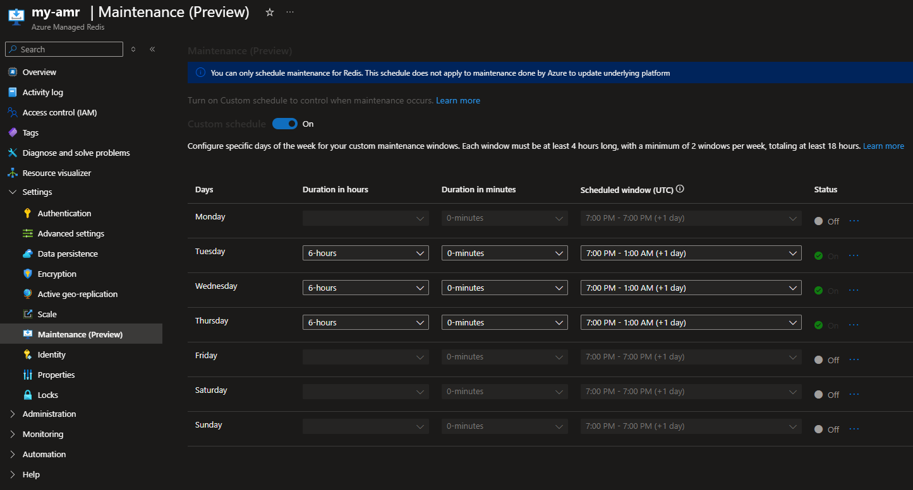

# Azure Managed Redis 维护窗口配置

本仓库的告警只能在维护**开始和结束时**通知，不能决定维护**什么时候**发生。AMR 的计划维护窗口（Scheduled maintenance，预览版）可以把大部分维护限制在业务低峰。两者配合使用：维护窗口决定维护尽量发生在什么时间，告警负责在维护开始和结束时通知。

本文只写通用配置方法，命令里的订阅、资源组和实例名都是占位符。

## 1. 功能说明

- 不配置时，Azure 自行决定维护时间；配置后，下列维护会**尽量**（best-effort）安排在你指定的时间段内。
- 功能目前是**预览版**。
- 窗口内维护的表现与平时一样：会做故障转移，连接会短暂中断，复制数据期间服务端 CPU 和内存负载会暂时升高。客户端必须有重试和自动重连；集群模式下还要能刷新集群拓扑。

### 受窗口约束的维护

- Redis 服务端软件更新和补丁
- 承载 Redis 的虚拟机的来宾操作系统更新
- 常规维护周期中的 Redis 小版本升级

### 不受窗口约束的维护（仍可能在窗口外发生）

- 底层 Azure 基础设施的主机操作系统更新
- Azure 网络组件更新
- 出于安全合规需要的紧急安全补丁
- Redis 大版本升级（单独管理，可推迟 90 天）

所以，**即使配置了维护窗口，窗口外仍可能收到本方案的维护告警**。

## 2. 窗口要求

| 要求 | 说明 |
|---|---|
| 单个窗口 | 至少 4 小时 |
| 每周窗口数 | 至少 2 个 |
| 每周总时长 | 至少 18 小时 |
| 时区 | 只能用 UTC |
| 开始时间 | 只能是整点 |
| 生效 | 修改后对之后的维护立即生效，正在进行的维护不受影响 |

窗口按“周几、几点（UTC）开始、持续多久”定义，可以跨过午夜。比如周一 UTC 16:00 开始、持续 6 小时，会一直到周一 UTC 22:00。

## 3. 选择窗口

1. 先确定业务所在地的低峰时段（按业务所在时区，而不是按 Azure 区域）。
2. 换算成 UTC。注意日期可能会变：北京时间（UTC+8）凌晨的时段，对应的是 UTC 的前一天。
3. 满足“每个窗口 ≥ 4 小时、每周 ≥ 2 个、合计 ≥ 18 小时”。

示例：业务低峰为北京时间周二到周四的 00:00–06:00，可以设 3 个各 6 小时的窗口，合计 18 小时：

| 窗口 | 开始（UTC） | 时长 | 对应北京时间 |
|---|---|---|---|
| 周一 | 16:00 | 6 小时（`PT6H`） | 周二 00:00–06:00 |
| 周二 | 16:00 | 6 小时 | 周三 00:00–06:00 |
| 周三 | 16:00 | 6 小时 | 周四 00:00–06:00 |

## 4. 方法一：Azure 门户

1. 打开 Azure Managed Redis 实例，在左侧菜单选择 **Settings → Maintenance (Preview)**。
2. 打开 **Custom schedule**。
3. 在要维护的日子那一行设置 **Duration in hours** / **Duration in minutes**，再在 **Scheduled window (UTC)** 选择开始时间（UTC 整点）；设置好的日子 Status 显示为 On，其他日子保持 Off。
4. 保存。

页面顶部的提示也说明了：这个计划只约束 Redis 自身的维护，不约束 Azure 更新底层平台的维护。



截图仅示意页面布局，实例名已替换。图中设置的是周二到周四、UTC 19:00 起各 6 小时（北京时间周三到周五 03:00–09:00），与第 3 节的示例不同，请按自己的业务低峰设置。

## 5. 方法二：Azure CLI

需要支持 `--maintenance-configuration` 参数的 `redisenterprise` 扩展。先升级扩展（只影响本机 CLI）：

```bash
az extension update --name redisenterprise
```

把窗口写进 `maintenance.json`（对应第 3 节的示例）：

```json
{
  "maintenance-windows": [
    {"type": "Weekly", "schedule": {"day-of-week": "Monday"},    "start-hour-utc": 16, "duration": "PT6H"},
    {"type": "Weekly", "schedule": {"day-of-week": "Tuesday"},   "start-hour-utc": 16, "duration": "PT6H"},
    {"type": "Weekly", "schedule": {"day-of-week": "Wednesday"}, "start-hour-utc": 16, "duration": "PT6H"}
  ]
}
```

设置维护窗口（显式指定订阅）：

```bash
az redisenterprise update --subscription <subscription-id> --resource-group <resource-group> --cluster-name <amr-name> --maintenance-configuration @maintenance.json
```

回读确认：

```bash
az redisenterprise show --subscription <subscription-id> --resource-group <resource-group> --cluster-name <amr-name> --query maintenanceConfiguration
```

注意：

- 用 `update` 修改现有实例，不要用 `create`。CLI 参考里 `create` 和 `update` 的说明都带有 “overwrite/recreate, with potential downtime” 的字样，所以**先在测试实例上执行并回读**，确认没有影响后再改生产实例，并安排在变更窗口内操作。
- `maintenanceWindows` 是一个整体列表，每次更新都是整组替换。修改时要把所有窗口一起写全，不能只写要改的那一个。

## 6. 方法三：Bicep / ARM 模板

实例本身用模板管理时，在 `Microsoft.Cache/redisEnterprise` 的 `properties` 中加入 `maintenanceConfiguration`（需要使用包含该属性的 API 版本，见模板参考的 change log）：

```bicep
maintenanceConfiguration: {
  maintenanceWindows: [
    {
      type: 'Weekly'
      schedule: {
        dayOfWeek: 'Monday'
      }
      startHourUtc: 16
      duration: 'PT6H'
    }
    // 其余窗口同样写法
  ]
}
```

| 字段 | 取值 |
|---|---|
| `type` | 目前只有 `Weekly` |
| `schedule.dayOfWeek` | `Monday` 到 `Sunday` |
| `startHourUtc` | 0–23，UTC 整点 |
| `duration` | ISO 8601 时长，例如 `PT6H` |

不要为了设置维护窗口单独写一个只含该实例的新模板去部署：PUT 会按模板内容设置整个实例（SKU、高可用、网络访问等）。应在已有的实例模板中加入这个属性。

## 7. 与维护告警的关系

| 能力 | 作用 | 不能做到 |
|---|---|---|
| 维护窗口 | 让大部分维护落在低峰时段 | 不能约束主机、网络、紧急安全补丁等维护；不会提前通知 |
| 本仓库的维护告警 | 维护开始和结束时推送飞书卡片 | 不是提前预告：通知大约在事件发生后 2–7 分钟到达，可能与故障转移同时或稍晚 |
| 客户端韧性 | 维护期间自动重试、重连、刷新集群拓扑 | — |

三者都需要：窗口用来减少维护对高峰业务的影响，告警让运维知道维护正在发生，客户端韧性决定维护期间业务实际受影响多久。

## 8. 验证状态

- 要求、限制和维护类型来自官方文档。
- CLI 参数格式来自官方 CLI 参考的示例；模板字段来自 ARM / Bicep 模板参考。
- 本仓库**没有**在真实实例上执行过上述设置命令。请先在测试实例上验证。

## 9. 参考

- [Scheduling time for cache maintenance - Azure Managed Redis](https://learn.microsoft.com/en-us/azure/redis/scheduled-maintenance)
- [Failover and patching for Azure Managed Redis](https://learn.microsoft.com/en-us/azure/redis/failover)
- [az redisenterprise（CLI 参考）](https://learn.microsoft.com/en-us/cli/azure/redisenterprise?view=azure-cli-latest)
- [Microsoft.Cache/redisEnterprise 模板参考](https://learn.microsoft.com/en-us/azure/templates/microsoft.cache/redisenterprise)
